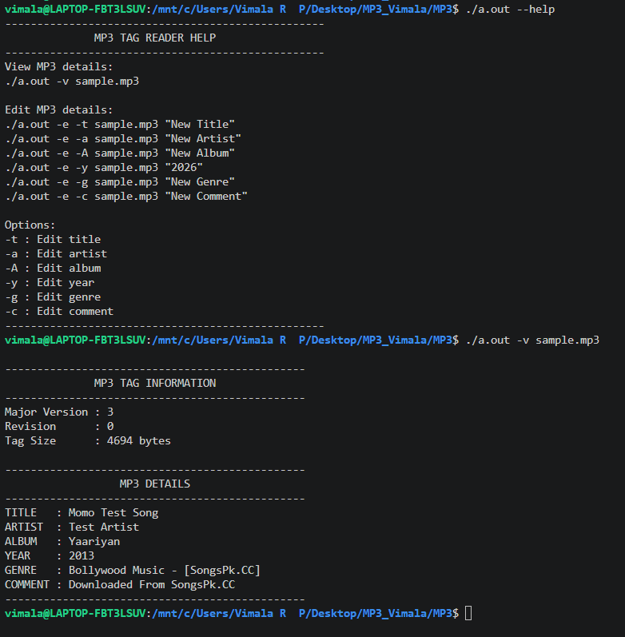
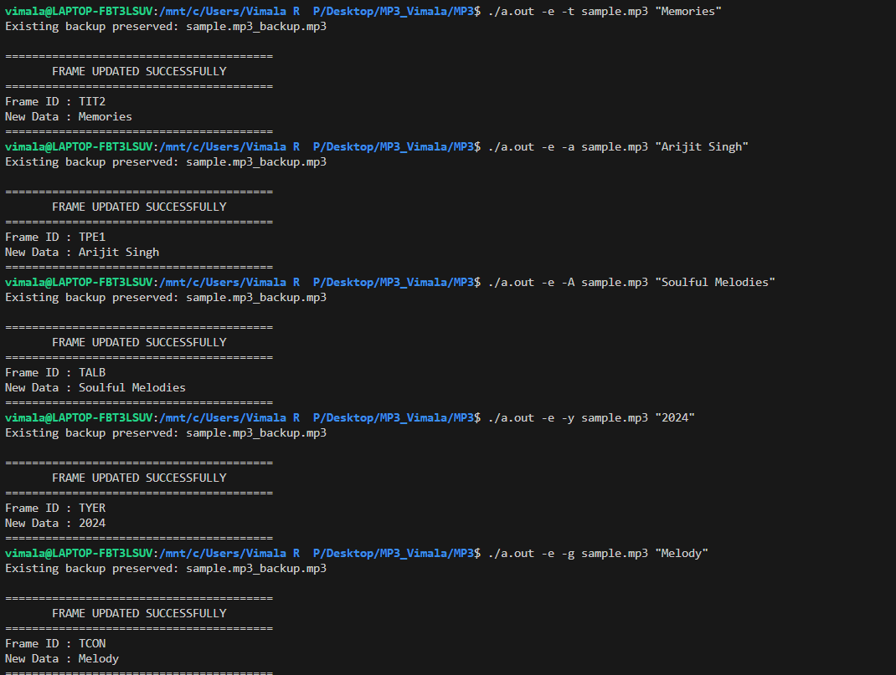
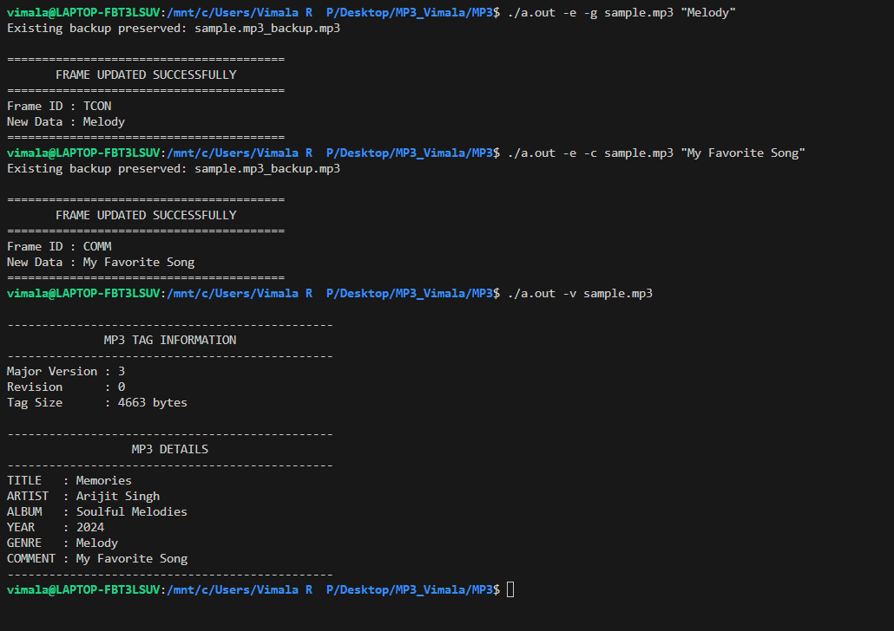

# 🎵 MP3 Tag Reader and Editor

### A C Programming Project for Reading and Editing MP3 Metadata

A command-line application developed in C to view and modify metadata stored in MP3 audio files using ID3v2.3 tags.

---

## 📌 Project Overview

MP3 files contain metadata that stores information about a song, including its title, artist, album, release year, genre, and comments.

The **MP3 Tag Reader and Editor** provides a command-line interface for viewing existing metadata and editing supported tag fields.

This project demonstrates practical applications of C programming, binary file handling, and modular program design.

## ✨ Features

| Feature              | Description                                      |
| -------------------- | ------------------------------------------------ |
| 📖 View MP3 Metadata | Display metadata extracted from an MP3 file      |
| 🎵 Edit Title        | Update the song title                            |
| 🎤 Edit Artist       | Modify the artist name                           |
| 💿 Edit Album        | Update the album name                            |
| 📅 Edit Year         | Modify the release year                          |
| 🎼 Edit Genre        | Update the genre                                 |
| 📝 Edit Comment      | Modify the comment field                         |
| ❓ Help Interface     | Display available commands and usage information |
| 🗂️ Backup Handling  | Preserve an existing backup when editing         |

## 🖼️ Project Screenshots

### 1. Help Interface and Metadata Viewer

Displays the available operations and demonstrates metadata viewing.



### 2. Editing MP3 Metadata

Demonstrates the supported metadata editing operations.



### 3. Verifying Updated Metadata

Shows the updated metadata after successful editing operations.



## 🛠️ Technologies and Concepts

* **Programming Language:** C
* **Metadata Format:** ID3v2.3
* **File Handling:** Opening, reading, writing, and closing files
* **Binary File Operations:** Processing MP3 data
* **Structures and Functions:** Organizing program logic
* **Command-Line Interface:** Handling user commands and options
* **Modular Programming:** Separating functionality across source files

## 📂 Project Structure

```text
MP3/
├── main.c       # Main program and command handling
├── view.c       # Metadata viewing functionality
├── edit.c       # Metadata editing functionality
├── help.c       # Help and usage information
├── header.h     # Shared declarations and definitions
├── README.md    # Project documentation
└── images/
    ├── 01_mp3_tag_reader_help_and_view.png
    ├── 02_mp3_tag_editor.png
    └── 03_mp3_tag_editor_result.png
```

## 🚀 Compilation and Usage

### Compile the Project

Compile the source files using GCC from the project directory:

```bash
gcc main.c view.c edit.c help.c -o mp3tag
```

### Display the Help Menu

```bash
./mp3tag --help
```

### View MP3 Metadata

```bash
./mp3tag -v sample.mp3
```

### Edit MP3 Metadata

The following examples demonstrate the supported editing options.

| Option | Metadata Field | Example                                        |
| ------ | -------------- | ---------------------------------------------- |
| `-t`   | Title          | `./mp3tag -e -t sample.mp3 "Memories"`         |
| `-a`   | Artist         | `./mp3tag -e -a sample.mp3 "Arijit Singh"`     |
| `-A`   | Album          | `./mp3tag -e -A sample.mp3 "Soulful Melodies"` |
| `-y`   | Year           | `./mp3tag -e -y sample.mp3 "2024"`             |
| `-g`   | Genre          | `./mp3tag -e -g sample.mp3 "Melody"`           |
| `-c`   | Comment        | `./mp3tag -e -c sample.mp3 "My Favorite Song"` |

**Note:** These examples assume that the executable is named `mp3tag` and that `sample.mp3` is available in the current directory. Use a test copy of an audio file when experimenting with metadata editing.

## 🎯 Learning Outcomes

Through this project, I gained practical experience in:

* Reading and modifying binary file data.
* Understanding MP3 metadata and ID3v2.3 frames.
* Working with file pointers and file operations in C.
* Organizing a program into multiple source files.
* Implementing metadata viewing and editing functionality.
* Testing program behavior through command-line operations.

## 👩‍💻 Author

**Vimala R P**

GitHub: [@vimala-rp](https://github.com/vimala-rp)

---

*Developed as a C programming project to explore file handling and MP3 metadata manipulation.*
